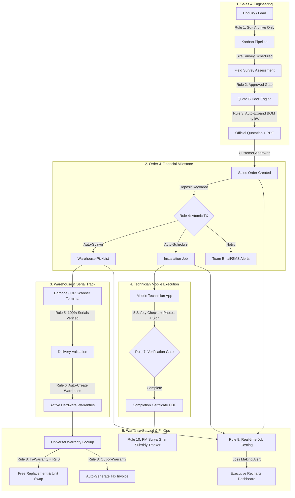

# SunPower Solutions - Solar Installation Management System (ERP)
> **Odoo-Inspired Enterprise Rooftop Solar ERP (`#714B67`)**  
> Tailored for rooftop solar EPCs (~40 projects/month, 15 technicians) covering the complete lifecycle:  
> **Enquiry → Site Survey → Auto-BOM Quote → Order & Deposit → Serial Scan Dispatch → Mobile Installation → Warranty Engine → Service Desk → Finance & Job Costing Dashboard**.

---

## 🏗️ System Architecture & Data Flow



---

## 🌟 Key Highlights & Hackathon Demo Features

1. **Instant 1-Click Persona Switcher**: Switch on the fly between **ADMIN**, **SALESMAN**, **WAREHOUSE**, **TECHNICIAN**, **SUPPORT**, and **CUSTOMER** directly from the header dropdown without logging out.
2. **Iconic Odoo Purple `#714B67` Aesthetic**: Curated glassmorphism design system (`.odoo-glass-card`), high-contrast badges, glowing status rings, and Google Fonts **Plus Jakarta Sans** & **JetBrains Mono**.
3. **Interactive Photovoltaic Array Simulator**: Quotation Studio includes a real-time responsive solar cell array visualizer reflecting exact module count as the kW capacity slider moves (1 to 10 kW).
4. **11 Strict Server-Enforced Business Rules**:
   - **Rule 1 (Leads)**: Never hard-deleted (archive only). 9-stage Kanban (`NEW` → `QUALIFIED` → `SURVEY_SCHEDULED` → `SURVEY_APPROVED` → `QUOTED` → `WON`/`LOST`).
   - **Rule 2 (Survey Gate)**: Quotes **CANNOT** be created unless the site survey is `APPROVED` by engineering (returns `400 Bad Request`).
   - **Rule 3 (Auto-BOM Expansion)**: Package template automatically scales Bill of Materials (panels, inverters, cables, earthing, structures) by system kW, allows line-item edits, and factors in GST 18% + MNRE subsidy notes.
   - **Rule 4 (Transaction Milestone)**: Order confirmation occurs upon advance payment. In **ONE atomic database transaction**, the system confirms the order, creates the Pick List, spawns the Installation Job, and sends team notifications.
   - **Rule 5 (Serial Validation Gate)**: Delivery validation requires scanned serials for all tracked items. Missing serials trigger a `400 Bad Request` with an exact itemized deficit breakdown.
   - **Rule 6 (Auto-Warranties)**: Validating delivery in **ONE atomic transaction** auto-creates active `Warranty` records with expiry date calculated as `startDate + product.warrantyYears`.
   - **Rule 7 (Mobile Installation Verification)**: Installation job can only transition to `COMPLETED` when start time, end time, confirmed kW, all 5 checklist verification steps are checked, ≥1 installation photo is provided, and customer signature is captured.
   - **Rule 8 (Warranty Engine & Replacement)**: Live search returns active/expired status and days remaining. In-warranty parts/labour cost ₹0; expired parts automatically generate a GST tax invoice. Swapping a defective component voids the old serial and starts a brand new warranty.
   - **Rule 9 (Job Costing)**: `Profit = Revenue - BOM Cost - Technician Labour Cost - Other Incident Expenses`. Loss-making jobs (`profit < 0`) are automatically flagged in high-contrast red alerts.
   - **Rule 10 (Subsidies & Tech Payouts)**: PM Surya Ghar government subsidy tracker per customer; automated technician wage payouts aggregated from verified `TimeEntry` records.
   - **Rule 11 (Audit Trail)**: Every status change and entity mutation writes an immutable `AuditLog` row with before/after state diffs.
5. **Direct Vector PDF Generation**: Server-side PDF generation (PDFKit) for Quotations, GST Tax Invoices, and Installation Completion Certificates.
6. **Public Expiring Share Link**: Generate tokenized, read-only live executive dashboards (Recharts) with customizable expiry (e.g., 7 days) for investors and auditors without authentication.

---

## 🛠️ Technology Stack

| Layer | Technologies |
| :--- | :--- |
| **Frontend** | React 19, Tailwind CSS v4 (`@tailwindcss/vite`), Lucide Icons, React Router v7, TanStack Query v5, Recharts, `html5-qrcode`, `react-signature-canvas` |
| **Backend** | Node.js + Express, **CommonJS ONLY** (`require`/`module.exports`) |
| **Database** | PostgreSQL + Prisma ORM (26+ models, schema migrations, complete demo seed) |
| **Authentication** | JWT + bcrypt, role-based route guards, and company multi-tenant isolation |
| **File Storage** | Cloudinary via multer memory storage with local base64/dataURI fallback |
| **PDF Generation** | PDFKit (Dynamic Quotations, Invoices, Certificates) |
| **Deployment** | Docker, Docker Compose, Vercel SPA configuration |

---

## 👥 Demo Accounts (Credentials)

All accounts share the default password: **`password123`**

| Role | Email | Persona & Primary Dashboard |
| :--- | :--- | :--- |
| **ADMIN** | `admin@sunpower.com` | Arjun Verma (Managing Director) — Full Analytics & Finance |
| **SALESMAN** | `sales@sunpower.com` | Priya Sharma (Sales Executive) — Lead Board & Quote Builder |
| **WAREHOUSE** | `warehouse@sunpower.com` | Rahul Verma (Inventory Manager) — Pick Lists & Serial Scanner |
| **TECHNICIAN** | `tech@sunpower.com` | Vikram Singh (Senior Installer) — Mobile Checklist & Signatures |
| **SUPPORT** | `support@sunpower.com` | Neha Patel (Customer Service) — Warranty Lookup & Tickets |
| **CUSTOMER** | `customer@sunpower.com` | Ananya Deshmukh (Client) — Live Milestone Tracker & Portal |

*(Tip: You can use the Quick-Switch dropdown at the top of the app sidebar to switch between any persona in 1 click!)*

---

## 📡 Complete REST API Reference (30+ Endpoints)

| Module | Method | Endpoint | Role Guard | Enforced Business Rule / Description |
| :--- | :--- | :--- | :--- | :--- |
| **Auth** | `POST` | `/api/v1/auth/login` | Public | Authenticates credentials, returns signed JWT & role |
| **Auth** | `GET` | `/api/v1/auth/me` | Authenticated | Fetches active persona profile scoped by `companyId` |
| **Leads** | `GET` | `/api/v1/leads` | Sales / Admin | Lists active non-archived leads in 9-stage pipeline |
| **Leads** | `POST` | `/api/v1/leads` | Sales / Admin | Creates new enquiry (Rule 1) |
| **Leads** | `PATCH` | `/api/v1/leads/:id/checklist` | Sales / Admin | Validates 3 qualification gates (roof, bill, grid) |
| **Leads** | `DELETE`| `/api/v1/leads/:id` | Sales / Admin | **Rule 1**: Soft-archives lead (never hard deletes) |
| **Surveys**| `POST` | `/api/v1/surveys/schedule` | Sales / Admin | Books on-site engineering assessment |
| **Surveys**| `PATCH`| `/api/v1/surveys/:id/review` | Sales / Admin | Approves or rejects site survey |
| **Inventory**| `GET`| `/api/v1/inventory/templates` | All Staff | Retrieves package BOM templates (e.g. 3kW / 5kW) |
| **Quotes** | `POST` | `/api/v1/quotes` | Sales / Admin | **Rule 2 & 3**: Rejects if survey not approved; scales BOM by kW |
| **Quotes** | `GET`  | `/api/v1/quotes/:id/pdf` | Sales / Admin / Client | Streams branded PDFKit quotation with subsidy note |
| **Orders** | `POST` | `/api/v1/orders` | Sales / Admin | Creates sales order from accepted quote |
| **Orders** | `POST` | `/api/v1/orders/:id/payments` | Sales / Admin | **Rule 4**: Atomically confirms order, creates PickList & Job |
| **Dispatch**| `GET` | `/api/v1/dispatch/pick-lists` | Warehouse / Admin | Lists active warehouse material pick lists |
| **Dispatch**| `POST`| `/api/v1/dispatch/scan-serial` | Warehouse / Admin | Scans barcode/QR serial string for tracked equipment |
| **Dispatch**| `POST`| `/api/v1/dispatch/orders/:id/validate` | Warehouse / Admin | **Rule 5 & 6**: Rejects if missing serials; auto-creates warranties |
| **Jobs**   | `GET`  | `/api/v1/jobs` | Tech / Admin | Retrieves technician installation job list |
| **Jobs**   | `PATCH`| `/api/v1/jobs/:id/complete` | Tech / Admin | **Rule 7**: Verifies 5 checkboxes, photo, confirmed kW & signature |
| **Jobs**   | `GET`  | `/api/v1/jobs/:id/certificate` | Tech / Admin / Client | Downloads PDFKit Handover & Completion Certificate |
| **Warranty**| `GET` | `/api/v1/warranty/search` | Support / Sales / Admin | **Rule 8**: Live query returning active/expired status & days left |
| **Tickets**| `POST` | `/api/v1/tickets/:id/lines` | Support / Admin | **Rule 8**: Auto-prices parts: ₹0 if covered, fee if expired |
| **Tickets**| `POST` | `/api/v1/tickets/:id/resolve` | Support / Admin | **Rule 8**: Auto-generates Tax Invoice; swaps unit & starts warranty |
| **Finance**| `GET`  | `/api/v1/finance/job-costing` | Admin | **Rule 9**: Analyzes BOM + labor + incidentals; flags red loss orders |
| **Finance**| `GET`  | `/api/v1/finance/subsidies` | All Staff | **Rule 10**: PM Surya Ghar subsidy tracking & bank disbursals |
| **Finance**| `GET`  | `/api/v1/finance/technician-payouts` | Admin | **Rule 10**: Aggregated technician labor wages from TimeEntries |
| **Dashboard**| `GET`| `/api/v1/dashboard/stats` | Admin | Executive KPIs, conversion velocity & stuck jobs report |
| **Dashboard**| `POST`| `/api/v1/dashboard/share` | Admin | Issues 7-day cryptographic public share link |
| **Dashboard**| `GET` | `/api/v1/dashboard/public/:token` | Public | Read-only executive telemetry for investors & auditors |
| **Dashboard**| `GET` | `/api/v1/dashboard/export-csv` | Admin | Exports complete CSV audit spreadsheet |
| **Customer** | `GET` | `/api/v1/customer-portal/me` | Customer | Client portal profile, timeline, warranties & proposals |
| **Customer** | `POST`| `/api/v1/customer-portal/sign-job/:id`| Customer | Captures customer digital signature on completion cert |

---

## 🚀 Quickstart & Local Setup

### Option 1: Standard Node.js Setup
```bash
# 1. Start PostgreSQL (e.g., localhost:5432)
# 2. Setup & Seed Backend
cd server
npm install
npx prisma migrate dev --name init_solar_management
npm run seed
npm run dev      # Server starts on http://localhost:5000

# 3. Setup & Start Frontend (in a new terminal)
cd ../client
npm install
npm run dev      # Client starts on http://localhost:5173
```

### Option 2: Docker Compose (1 Command)
```bash
docker-compose up --build
```

---

## 🧪 Automated Verification Test Suites

Verify all 11 business rules against live database transactions:

```bash
cd server

# Verify Phase 1 to Phase 4 (Leads, Surveys, Quotes, Orders, Picklists, Serial Scanning, Delivery)
node test_phase3_phase4.js

# Verify Phase 5 & Phase 6 (Installation Job Completion, Warranties, Swaps, Costing, PDFs, Shared Dashboard)
node test_phase5_phase6.js
```

---

## 🎤 3-Minute Hackathon Demo Pitch Script

1. **Minute 1: The Problem & Commercial Velocity (Salesman Persona)**
   - *"Rooftop solar companies face massive revenue leaks between site surveys and warehouse release."*
   - Switch to **SALESMAN**. Open Kanban. Highlight the 9-stage pipeline and show how Rule 1 ensures leads are never lost.
   - Show that attempting to quote an unapproved lead is blocked by **Rule 2**.
   - Open **Quotation Studio**: Adjust the kW slider to 5 kW, demonstrate the **real-time Photovoltaic Solar Array Simulator** rendering Tier-1 modules, watch the Bill of Materials dynamically expand (Rule 3), and download the official PDFKit proposal.
2. **Minute 2: The Operational Milestone (Warehouse & Technician)**
   - Switch to **SALESMAN**: Record an advance deposit. Show that in **ONE atomic transaction (Rule 4)**, the order confirms, the warehouse Pick List generates, and the installation job is spawned.
   - Switch to **WAREHOUSE**: Open the **Barcode Scanner Terminal**. Click *1-Click Demo Scan*. Attempt to validate delivery without all units — show the **Rule 5 error** detailing missing serials. Complete the scan and validate: **Rule 6 auto-generates 11 active warranties**.
   - Switch to **TECHNICIAN**: Open the mobile install form. Check the 5 safety items, enter confirmed kW, capture the customer digital signature, and download the vector **Completion Certificate PDF (Rule 7)**.
3. **Minute 3: Customer Trust & Financial Audits (Support & Executive)**
   - Switch to **SUPPORT**: Type serial `INV3K-SN-001` into the **Universal Warranty Lookup**. Show active countdown chips. Demonstrate how replacing an in-warranty part is ₹0.00 while an expired part triggers an automated GST tax invoice (Rule 8).
   - Switch to **ADMIN**: Review the Executive Dashboard. Point out the **Rule 9 Job Costing red flag** on order `SO-2026-LOSS` (-25% margin). Click *Expiring Share Link*, copy the link, and show the read-only live dashboard accessible to bank managers and investors.